# Native debug FPKG backend: audit and architecture

Issue: [ShadowMountPlus #221](https://github.com/drakmor/ShadowMountPlus/issues/221)

This document records the Phase 0 audit and implementation progress as of
2026-11-14. It separates source facts, implemented host-testable primitives,
and remaining work. No game package or PS5 SDK is present in the host
environment.

## Repository and reference pins

| Project | Revision inspected | License | Notes |
| --- | --- | --- | --- |
| ShadowMountPlus | `8b1f48e086bed93e1ad53158d1103054e362f54d` (`1.7`) | GPL-3.0 | Upstream default branch is `1.7`. |
| Kraken Mount | `4b420d579bd381796d773875e36d14c9acaabf39` (`main`) | GPL-3.0-or-later | Reader, decoder, cache, index writer and launch reference. |
| ampr-emu-ng | `920e9172b6bf99bd9210361b545e2953659d1e9b` (v0.4.0 source) | GPL-3.0-or-later | Exact source revision corresponding to Kraken's bundled runtime. |
| bundled AMPR runtime | v0.4.0, SHA-256 `8320eb65c16565f42031b9d88b15a447039f0fd7e5694faf5f1cb84cafdba218` | GPL-3.0-or-later | Kraken `vendor/ampr-emu-ng/SHA256SUMS`; binary is not copied into SMP. |
| ps5-dump-forge | `8a3c7d3e4bfeac3b4ddf8e9ff020e819ae8ff1cd` (`main`) | GPL-3.0 | Its Rust tests generate temporary plaintext FPKGs from synthetic files; no game content or fixture binary is shipped. |

SMP, Kraken Mount, ampr-emu-ng and ps5-dump-forge all state GPL-3.0-compatible
terms. A native port derived from Kraken remains GPL-covered; it must preserve
attribution and the repository's GPL distribution terms. No Rust, Cargo runtime,
Kraken daemon or proprietary game data is part of the planned SMP implementation.

PR #200 (`quer3q/ShadowMountPlus`, head `3663a32e56130c722ee0aa77623be5f19d5674ee`)
is still open against `1.7`, not part of the inspected SMP baseline. It proposes
recognizing/updating AMPR NG in fakelib and must be reconciled before runtime
integration. PR #206 is also open against `1.7` (head
`3596e602f7c1c89faff53d55215fc02e89a48703`); it changes same-title process
handoff to reuse a prepared/mounted runtime before binding the replacement
process. That lifecycle ownership behavior must be reconciled before adding a
new launch layer. PR #215 was closed unmerged and is an unrelated Trail/docs
change. The connected GitHub account has read-only permission on upstream.

## Kraken function map

| Kraken function/file | SMP existing equivalent | Missing function | Proposed native module |
| --- | --- | --- | --- |
| `crates/kraken-mount-pkg/src/pkg.rs`: FIH/CNT inspection and package open | `sm_pkg_parse_stream` / `sm_pkg_parse_file` in `src/sm_pkg.c` parse package metadata and classify installable content | A separate eligibility decision for full, plaintext PS5 debug FPKG without changing installer classification | `src/sm_fpkg.c`, `include/sm_fpkg.h` |
| `outer.rs`: PFS geometry, superblock, dinodes, direct/indirect extents | no reader of package outer PFS | Bounded outer filesystem reader and integrity/alias policy | `src/sm_fpkg_outer.c` (or private section of `sm_fpkg.c`) |
| `tree.rs`: inner PFS entries and paths | scanner handles folders and recognized disk images, not FPKG inner trees | Persist a normalized file index, map file extents and feed extraction planning | `src/sm_fpkg_tree.c` |
| `kraken.rs`, `decoder/{mod,huff,lz,timing}.rs` | none | Kraken block mapping and decoder | `src/sm_fpkg_layout.c`, `src/sm_fpkg_decoder.c` |
| `src/ampr_index.rs` | SMP has AMPR update/fakelib support but no AMPR index writer | exact AMPRIDX3 and AMPRPAK4 writer for codec 2 | `src/sm_fpkg_index.c` |
| `src/cache.rs` | `sm_game_cache.c`, scanner/install queue and SMP state own related caches | FPKG extraction/index cache with owned-file journal; never clear ambiguous cache | extend existing cache owner after design review; no parallel cache daemon |
| `src/launch.rs` | `sm_game_lifecycle.c`, `sm_fakelib.c`, mount manager and mount identity tracking | mount the FPKG parent directory into sandbox `app0/kraken` and record ownership | minimal FPKG layer in existing launch/mount owner |
| `register.rs` / `watcher.rs` | appdb registration and game lifecycle/scanner | source-kind persistence and launch routing | extend existing SMP records only after cache validation |

The proposed C module names are placeholders until local conventions and ownership
are confirmed in implementation. They are not permission to duplicate existing
SMP owners.

## Current SMP call path

```mermaid
flowchart LR
  A[sm_scanner / sm_scan] --> B[stable source and directory/image discovery]
  B --> C[sm_pkg metadata parser and scan candidate]
  C --> D[install queue / appdb registration]
  D --> E[title state and cache]
  E --> F[game lifecycle event and title owner]
  F --> G[sandbox identity and readiness]
  G --> H[owned mount layers / fakelib / backport]
  H --> I[game exit, switch, sleep or shutdown cleanup]
```

FPKG support must branch after existing PKG metadata parsing and retain its
source snapshot. It must not enter the existing package installer queue. Cache
publication precedes registration. Launch and unmount remain owned by SMP's
existing title lifecycle and mount-state mechanisms.

## AMPR compatibility matrix (reference source inspected)

| Source/runtime mode | Detection | Library injection | Runtime reads | FPKG backend relationship |
| --- | --- | --- | --- | --- |
| Plain folder | Existing SMP source/mount path | Existing SMP fakelib behavior; PR #200 proposes NG-specific handling | Not console-verified here | Preserve |
| ZSTD folder | Existing AMPR NG detects `ampr_zstd.index` | Existing fakelib path; NG identity/update behavior depends on PR #200 | Not console-verified here | Unchanged |
| LZ4 folder (`AMPRPAK4`) | Existing AMPR NG detects `ampr_assets.index` | Existing fakelib path; NG identity/update behavior depends on PR #200 | Not console-verified here | Unchanged |
| Plaintext debug FPKG | AMPR NG v0.4.0 `crates/ampr-sys/src/rt/pack/pkg.rs` selects `pkg` mode and reads `/app0/kraken.image` | Requires compatible AMPR NG in game fakelib | Source confirms code path; SMP launch is unverified | Generate AMPRIDX3 and AMPRPAK4 codec-2 records; mount package parent directory |

The v0.4.0 source was inspected at commit
`920e9172b6bf99bd9210361b545e2953659d1e9b`. Its `crates/ampr-pkg/src/manifest.rs`
validates the AMPRPAK4 header, CRCs, record sizes, offsets, page flags and codec
value 2 for pack 0; `crates/ampr-pkg/src/lib.rs` defines codec 2 as Kraken and
the full-block flag as `0x10`. The runtime package reader calls the Kraken block
decoder using worker-owned scratch memory. These source checks establish a
format target, not acceptance of a future C writer or a console launch result.

## Trust boundaries and ownership

| Operation | Existing owner / guard | FPKG-specific requirement |
| --- | --- | --- |
| Scan roots, source stability, removable media | `sm_scanner`, `sm_scan`, stability and storage/mount state | Reuse the same stable snapshot; detect replacement before commit. |
| PKG metadata/classification | `sm_pkg.c` | Keep one metadata parser; add a distinct full-debug-FPKG eligibility result. |
| Duplicate title resolution and appdb registration | scanner, install queue, appdb | Refuse collisions and preserve prior registration until publication validates. |
| Game launch, sandbox readiness and game switching | lifecycle worker and title/mount state; `runtime_mount_state_lock` in `main.c` protects runtime mount state | Require one unambiguous sandbox and keep a per-session mount identity/source record. |
| Fakelib, AMPR and backports | `sm_fakelib.c`, config and existing mount stack | Reconcile PR #200; preserve precedence and never replace a selected user runtime silently. |
| Cache creation and cleanup | existing game cache / install machinery | Add per-title exclusion under lifecycle ownership; do not mutate while active or ambiguous. |
| Elevated mount/appdb calls | PS5 SDK / kernel-backed SMP abstractions | Validate and stage all source-derived data before invoking them. |

Inputs crossing trust boundaries include package bytes, package path components,
scan/API/UI requests, cache state files, removable media and mount-table
observations. Risks to handle include truncated headers, malformed CNT tables,
integer overflow, recursive/aliased blocks, huge inode counts, deep trees,
decompression bombs, invalid UTF-8, normalized/case-folded path collisions,
symlink swaps, corrupt ownership manifests, USB removal, power loss, process
death, duplicate title IDs, incompatible/missing AMPR, stale sandbox paths, fsid
mismatch, and active sessions. Malformed input must fail closed before writes.

## Confirmed reference risks (not exploit claims)

Evidence below is from Kraken Mount revision
`4b420d579bd381796d773875e36d14c9acaabf39`:

| Source | Confirmed behavior | Required SMP treatment |
| --- | --- | --- |
| `src/cache.rs:170-174` | `clear_build` falls back to `empty_dir` when `.built` cannot be read. | Do not port. Missing/corrupt ownership data must quarantine/defer, never authorize deletion. |
| `src/cache.rs:174-177` | `fakelib` is recursively deleted before it is recomposed. | Do not apply to an SMP cache containing unknown/game-created files. Replace only validated backend-owned files. |
| `src/cache.rs:501-520` | Cache rebuild clears old generated files before new build validation completes; failed build removes paths created during that attempt. | Use staged generation plus journal; preserve previous good generation and unknown paths. |
| `src/cache.rs:103-119` | Extract opens destination with create/truncate and creates parents by path. | Use directory-relative no-follow operations, private staging and exclusive creation. |
| `src/cache.rs:380-412` | Freshness parse defaults malformed `.done` to an empty value and reports stale. | A stale signal may schedule a safe rebuild; it must never imply cleanup ownership. |
| `src/launch.rs` session code | Kraken tracks fsids for its mount layers and sandbox path, which is a useful ownership model. | Extend SMP's own mount identity record; never unmount by path alone. |
| `src/launch.rs:837-867` | On `EBUSY`, retries every 250 ms for 10 seconds, then attempts one `MNT_FORCE` unmount and drops the session after that attempt. | SMP must retain its ownership/session-generation checks; defer and report if mount identity is ambiguous. Do not copy the forced fallback. |
| `crates/kraken-mount-pkg/src/outer.rs:1-3` | The reader explicitly says plaintext outer PFS SHA3 fields are not checked. | Do not claim integrity validation. Record the omission; assess whether verification is feasible and bounded. |
| `outer.rs:77-89` | `parse_dinodes` bounds returned nodes to one supplied block and silently clamps to fit. | Validate inode count against the format and available tables; reject unsupported geometry rather than silently truncate. |
| `outer.rs:197-223` | Indirect traversal descends by finite level but does not track repeated block aliases. | Bound depth and records, detect invalid alias/cycle patterns, and validate all extents. |

These observations describe reference implementation behavior only; whether a
particular input can exploit it is unproven.

## Host baseline and planned files

The baseline `make` cannot start because `/opt/ps5-payload-sdk/toolchain/prospero.mk`
is absent. Host tools are Apple Clang 21 and Python 3.14. Docker is unavailable.
The existing host test scripts were run on macOS; outcomes and their platform
blockers are in [fpkg-test-results.md](fpkg-test-results.md).

Planned implementation areas, gated in order:

1. `src/sm_fpkg*.c`, `include/sm_fpkg*.h`, host-only FPKG tests and attribution:
   bounded reader/parser/decoder. The implemented probe validates the FIH
   header, bounded CNT entry table, plaintext outer-PFS metadata entries, and
   their direct/indirect block maps. It reads the mapped
   `naps_pkg_layout.dat` into bounded memory and passes it to a standalone
   Kraken layout parser, implemented with a 384 MiB descriptor cap, 4,194,304
   block/boundary cap,
   sparse/shuffle rejection and stored-range overlap checks. The outer metadata
   file-map cap is 4,194,304 64 KiB blocks (256 GiB per file). The descriptor
   is checked against the declared `pfs_image.dat` size. The probe decodes the
   inner image on demand and validates its superblock, inode table and bounded
   directory tree. It does not yet extract files. The native decoder
   handles raw blocks, literal and match LZ commands, delta literals and
   Huffman-coded arrays; differential coverage currently uses synthetic vectors
   only. Do not duplicate `sm_pkg` metadata handling.
2. `src/sm_fpkg_index.c` now builds AMPRIDX3 and AMPRPAK4, including codec-2
   records. One synthetic output passed the pinned AMPR v0.4.0 parser; golden
   byte-comparison, broader record coverage and selected chunk readback remain.
3. Existing cache owner, with transaction journal, source fingerprint and disabled
   configuration key in `sm_config_mount.c`, config file/API surfaces as needed.
4. Scanner/registration/lifecycle/mount path extensions, only after prior gates.
5. CI, user-facing status/docs and PS5-only scenarios.

Likely commands: `make clean all` with the SMP PS5 SDK; the existing commands in
`tests/README.md`; host FPKG tests with `-fsanitize=address,undefined`; the pinned
Kraken differential oracle and AMPR manifest/readback checks; then GitHub Actions
Linux CI. This Mac has no PS5 SDK, Docker or console.

## Decision record

Use a native C11/gnu11 backend in SMP rather than Rust FFI. SMP's build discovers
`src/sm_*.c` directly and already owns scanning, metadata, cache, registration,
fakelib, lifecycle and mount cleanup. Rust FFI would introduce a second toolchain
and runtime boundary without moving ownership closer to the existing code. A
second daemon would duplicate title registration, lifecycle and mount ownership.
The C backend will be a bounded library called by those existing SMP owners; it
will not include a watcher, web server or appdb implementation.
